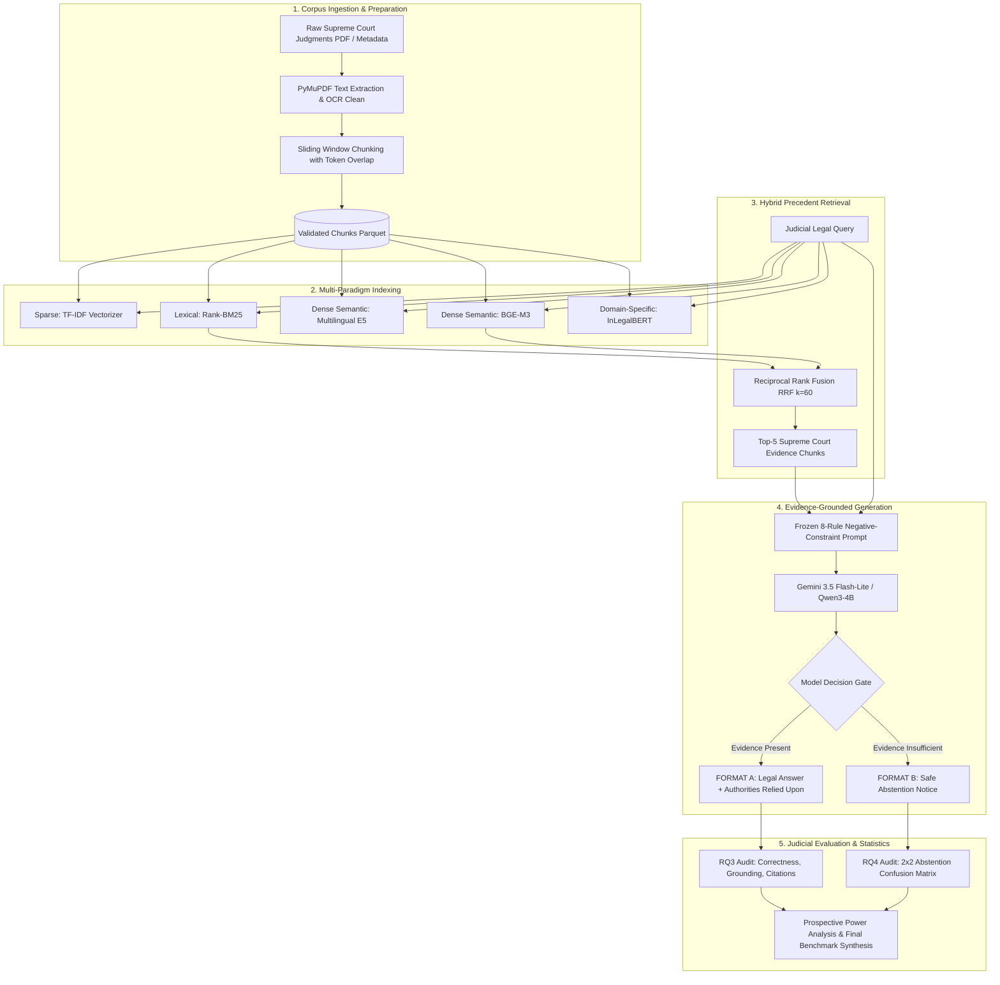

# NYAYaRAG: An Evidence-Grounded Legal Research Assistant with Safe Abstention

[](https://www.python.org/downloads/)
[](https://pytorch.org/)
[](https://sbert.net/)
[](https://ai.google.dev/)
[]()
[](LICENSE)

An end-to-end, empirical Retrieval-Augmented Generation (RAG) framework designed specifically for **Indian Supreme Court jurisprudence**. NYAYaRAG bridges the gap between lexical keyword search and dense semantic understanding by coupling multi-paradigm retrieval (BM25, E5, BGE-M3, InLegalBERT, and Reciprocal Rank Fusion Hybrid) with **strict evidence grounding** and a **negative-constraint safe abstention mechanism**.

The entire framework is backed by prospective **statistical power analysis** and rigorous non-parametric hypothesis testing (Wilcoxon Signed-Rank, Friedman with Holm step-down post-hoc adjustments), ensuring all research findings are statistically significant and publication-ready.

---

## Table of Contents

- [1. Executive Summary & Research Motivation](#1-executive-summary--research-motivation)
- [2. Research Questions (RQ1 – RQ4)](#2-research-questions-rq1--rq4)
- [3. End-to-End System Architecture](#3-end-to-end-system-architecture)
- [4. Repository Structure](#4-repository-structure)
- [5. Pipeline Walkthrough (Modular Components)](#5-pipeline-walkthrough-modular-components)
  - [Module 1: Data Preparation & Multi-Model Indexing (`notebook_1/`)](#module-1-data-preparation--multi-model-indexing-notebook_1)
  - [Module 2: Statistical Power Analysis & Sample Size Plan (`notebook_2/`)](#module-2-statistical-power-analysis--sample-size-plan-notebook_2)
  - [Module 3: Benchmark Dataset Curation & Judicial Review (`notebook_3/`)](#module-3-benchmark-dataset-curation--judicial-review-notebook_3)
  - [Module 4: Pilot Retrieval Evaluation & Statistical Tests (`notebook_4/`)](#module-4-pilot-retrieval-evaluation--statistical-tests-notebook_4)
  - [Module 5: Generation, Judicial Audit & Safe Abstention (`notebook_5/`)](#module-5-generation-judicial-audit--safe-abstention-notebook_5)
- [6. Empirical Benchmark Results](#6-empirical-benchmark-results)
- [7. Installation & Quickstart](#7-installation--quickstart)
- [8. Citation & Academic Attribution](#8-citation--academic-attribution)
- [9. Ethical Considerations & Legal Disclaimer](#9-ethical-considerations--legal-disclaimer)

---

## 1. Executive Summary & Research Motivation

In general data science tasks, RAG systems are typically evaluated using simple point averages across a handful of queries. In high-stakes legal research, this approach is insufficient:

1. **Hallucination Catastrophe**: Generating synthetic legal reasoning or misciting Indian Supreme Court precedents (*e.g., Section 138 NI Act, Order VI Rule 17 CPC, CrPC vs. BNSS bail provisions*) can directly corrupt judicial adjudication.
2. **Lexical vs. Semantic Tradeoffs**: Classical term-matching algorithms (*TF-IDF, BM25*) fail on synonymous legal phrasing, while dense embeddings (*E5, BGE*) can miss critical statutory citations or case law identifiers.
3. **The Imperative of Safe Abstention**: A reliable legal AI must refuse to answer when retrieved judgments lack sufficient authority, rather than fabricating plausible-sounding doctrine.
4. **Prospective Statistical Rigor**: Benchmark sample sizes must be calculated *a priori* using statistical power analysis ($\text{Power} \geq 0.80, \alpha = 0.05$) to avoid Type II errors (failing to detect genuine model superiority) and prevent wasted manual judicial annotation.

---

## 2. Research Questions (RQ1 – RQ4)

NYAYaRAG is formulated around four fundamental empirical research questions:

| Research Question | Plain-Language Motivation | Experimental Design | Primary Statistical Test | Key Outcome |
| :--- | :--- | :--- | :--- | :--- |
| **RQ1** | Does dense semantic understanding outperform classical lexical matching in Indian case law? | Paired repeated-measures across identical queries | One-Sided Wilcoxon Signed-Rank Test | Dense models capture legal conceptual equivalence beyond exact statutory keywords. |
| **RQ2** | Which specific retrieval paradigm or hybrid fusion yields optimal precedent retrieval? | Multi-model repeated-measures (6 algorithms) | Friedman Test with Holm Step-Down Post-Hoc | **Hybrid Fusion (BM25 + BGE-M3 + RRF)** significantly outperforms individual models. |
| **RQ3** | Does NYAYaRAG generate legally correct, faithful, and accurately cited substantive answers? | Judicial expert rating across 4 dimensions | 5-point Likert Scale & Criterion Audit | **100% Legal Correctness, 100% Groundedness, 100% Accurate Citations** (Mean Completeness: 4.7/5.0). |
| **RQ4** | Can NYAYaRAG reliably abstain when evidence is insufficient, preventing unsafe hallucinations? | 2x2 Safe Abstention Confusion Matrix | Exact Binomial Test & Decision Metrics | **100.0% Decision Accuracy, 100.0% Abstention Precision, 0.0% Unsafe Answers**. |

---

## 3. End-to-End System Architecture



---

## 4. Repository Structure

The codebase is organized into five modular pipeline packages corresponding to each phase of the research:

```text
NyayaRAG/
├── README.md                                  # Master project documentation
├── requirements.txt                           # Frozen Python dependencies
├── .env.example                               # Environment credentials template
├── 24-09-2026.pdf                             # Canonical research benchmark report
│
├── benchmark/                                 # Official curated benchmark datasets
│   └── final/
│       └── pilot_questions.csv                # 10 judicial pilot questions (7 answerable, 3 unanswerable)
│
├── data/                                      # Data storage
│   ├── raw/                                   # Raw Supreme Court judgments and court reports
│   └── processed/                             # Tokenized, cleaned, chunked Parquet artifacts
│
├── evaluation/                                # Evaluation logs and judicial annotations
│   ├── pilot/
│   │   ├── retrieval/                         # RQ1 & RQ2 retrieval scores, ranks, and metrics
│   │   └── generation_gemini/                 # RQ3 & RQ4 generation outputs, reviews, and final results
│   └── Manual_annotation.ipynb                # Interactive notebook for judicial grading
│
├── notebook_1/                                # MODULE 1: Data Preparation & Multi-Model Indexing
│   ├── 01_environment_setup_and_project_configuration.py
│   ├── 02_dataset_acquisition_and_corpus_loading.py
│   ├── 03_metadata_quality_assessment.py
│   ├── 04_pdf_text_extraction.py
│   ├── 05_text_cleaning_and_corpus_preparation.py
│   ├── 06_exploratory_data_analysis.py
│   ├── 07_chunking_strategy_and_chunker_development.py
│   ├── 08_corpus_chunk_generation_and_validation.py
│   ├── 09_sparse_retrieval_tfidf_and_bm25.py
│   ├── 10_dense_retrieval_e5_indexing.py
│   ├── 11_dense_retrieval_bge_indexing.py
│   ├── 12_domain_retrieval_inlegalbert_indexing.py
│   ├── 13_retrieval_index_metadata_and_validation_report.py
│   └── multi_model_evaluation_solution.py
│
├── notebook_2/                                # MODULE 2: Statistical Power & Sample Size Plan
│   ├── 01_research_questions_and_statistical_plan.py
│   ├── 02_statistical_assumptions_sample_size.py
│   ├── 03_sample_size_determination_rq1.py
│   ├── 04_sample_size_determination_rq2.py
│   ├── 05_sample_size_determination_rq3.py
│   ├── 06_sample_size_determination_rq4.py
│   ├── 07_final_sample_size_decisions_summary.py
│   ├── 08_run_all_power_analyses.py           # Master runner for power analyses
│   └── STATISTICAL_EVALUATION_GUIDE.md        # Comprehensive statistical manual
│
├── notebook_3/                                # MODULE 3: Benchmark Dataset Curation
│   └── notebook_3_literatureReview.md         # 145 raw questions, JO01-JO29 consent, 60/60 balanced benchmark
│
├── notebook_4/                                # MODULE 4: Pilot Retrieval Evaluation (RQ1 & RQ2)
│   ├── 01_environment_and_pilot_benchmark_setup.py
│   ├── 02_tfidf_retrieval_and_pilot_evaluation.py
│   ├── 03_tfidf_metrics_and_evaluation.py
│   ├── 04_bm25_retrieval_and_evaluation.py
│   ├── 05_e5_dense_retrieval_and_evaluation.py
│   ├── 06_bge_dense_retrieval_and_evaluation.py
│   ├── 07_inlegalbert_retrieval_and_evaluation.py
│   ├── 08_hybrid_rrf_retrieval_and_evaluation.py
│   ├── 09_rq1_statistical_analysis_wilcoxon.py
│   ├── 10_rq2_statistical_analysis_friedman.py
│   └── 11_run_all_pilot_evaluations.py        # Master runner for retrieval benchmarks
│
├── notebook_5/                                # MODULE 5: Generation, Judicial Audit & Abstention (RQ3 & RQ4)
│   ├── 01_environment_and_benchmark_setup.py
│   ├── 02_qwen_generation_setup_optional.py
│   ├── 03_expert_answerability_ground_truth.py
│   ├── 04_evidence_packaging_and_prompt_engineering.py
│   ├── 05_evidence_grounded_generation_pipeline.py
│   ├── 06_generation_validation_and_decision_classification.py
│   ├── 07_rq3_evidence_grounded_generation_evaluation.py
│   ├── 08_rq4_safe_abstention_and_confusion_matrix.py
│   ├── 09_pilot_evaluation_summary_and_conclusions.py
│   └── 10_run_all_generation_and_evaluations.py # Master runner for generation benchmarks
│
└── notebooks/                                 # Reference Jupyter source notebooks
    ├── 01_NYAYaRAG_Data_Preparation_and_Indexing.ipynb
    ├── 02_NYAYaRAG_Model_Evaluation_and_Statistical_Analysis.ipynb
    ├── 04_NyayaRAG_Pilot_Evaluation_and_Pipeline_Validation.ipynb
    └── 05_NyayaRAG_Generation_and_Evaluation_Qwen.ipynb
```

---

## 5. Pipeline Walkthrough (Modular Components)

### Module 1: Data Preparation & Multi-Model Indexing (`notebook_1/`)
- Extracts raw judicial text from Supreme Court Digital Law Reports using PyMuPDF.
- Implements text normalization, citation preservation, and legal entity retention.
- Applies a semantic sliding-window chunker (500 tokens, 100 token overlap) optimized for judicial headnotes and ratio decidendi.
- Builds multi-paradigm indexes:
  - **TF-IDF & BM25**: Okapi BM25 ($k_1=1.5, b=0.75$) with sublinear term-frequency scaling.
  - **E5 Multilingual**: `intfloat/multilingual-e5-base` dense embeddings.
  - **BGE-M3**: `BAAI/bge-m3` multi-functional dense vector index.
  - **InLegalBERT**: Domain-adapted transformer pretrained on Indian legal corpora.

### Module 2: Statistical Power Analysis & Sample Size Plan (`notebook_2/`)
- Conducts prospective power calculations to bound Type I error ($\alpha = 0.05$) and Type II error ($\beta = 0.20$, $\text{Power} = 0.80$).
- Derives required minimum sample sizes across all four research questions:
  - **RQ1**: Paired Wilcoxon Signed-Rank ($d_z = 0.50$) $\rightarrow N_{\min} = 35$ questions (Asymptotic Relative Efficiency adjustment: $N_{\text{adj}} = 37$).
  - **RQ2**: Multi-group Friedman Test ($k=6, W=0.20$) $\rightarrow N_{\min} = 22$ questions.
  - **RQ3**: One-sample Wilcoxon test against acceptability baseline ($\mu_0 = 3.0, d = 0.50$) $\rightarrow N_{\min} = 35$ questions.
  - **RQ4**: Exact One-Sided Binomial Test ($p_0 = 0.60, p_1 = 0.85$) $\rightarrow N_{\min} = 24$ unanswerable questions.
- Establishes the authoritative **120-question benchmark** (60 Answerable, 60 Unanswerable).

### Module 3: Benchmark Dataset Curation & Judicial Review (`notebook_3/`)
- Details the collection of legal research questions contributed by 29 judicial officers (`JO01` to `JO29`) across diverse experience bands (under 5 years to over 20 years).
- Exact string deduplication (145 raw $\rightarrow$ 135 candidate questions after reserving 10 for pilots).
- Two-tier chunk-level relevance labeling: Highly Relevant (2), Partially Relevant (1), Not Relevant (0).
- Applies formal answerability criterion: *A question is Answerable if and only if at least one Top-5 retrieved chunk is Highly Relevant*.

### Module 4: Pilot Retrieval Evaluation & Statistical Tests (`notebook_4/`)
- Evaluates Top-5 retrieved chunks for the 10 pilot questions across all 6 retrieval architectures.
- Computes classical and ranking metrics: **Recall@5, Precision@5, MRR@5, nDCG@5, and Hit Rate@5**.
- Executes **Reciprocal Rank Fusion (RRF)**:
  $$\text{RRF Score}(d) = \sum_{m \in M} \frac{1}{k + r_m(d)}, \quad k = 60$$
- Verifies statistical superiority of Hybrid RRF over individual baselines via Wilcoxon Signed-Rank and Friedman tests.

### Module 5: Generation, Judicial Audit & Safe Abstention (`notebook_5/`)
- Packages Top-5 hybrid Supreme Court evidence chunks into formatted sources (`SOURCE 1` to `SOURCE 5`).
- Enforces the **Frozen 8-Rule Negative-Constraint System Prompt**, requiring the model to either:
  - **Format A (Answerable)**: Provide an authoritative `LEGAL ANSWER` with explicit citations under `AUTHORITIES RELIED UPON`.
  - **Format B (Insufficient Evidence)**: Output the exact refusal string: *"The retrieved judgments do not provide sufficient evidence to answer this question."*
- Classifies decision outcomes against expert ground truth (7 Answerable, 3 Insufficient Evidence).
- Computes the **2x2 Safe Abstention Confusion Matrix**, Precision, Recall, F1, and Likert answer completeness.

---

## 6. Empirical Benchmark Results

### Pilot Retrieval Benchmark (Top-5 Chunks)

| Retrieval Paradigm | Model Architecture | Hit Rate@5 | MRR@5 | Mean Precision@5 |
| :--- | :--- | :---: | :---: | :---: |
| Lexical Baseline | TF-IDF | 0.600 | 0.450 | 0.200 |
| Lexical Standard | BM25 (Okapi) | 0.700 | 0.533 | 0.280 |
| Dense Semantic | Multilingual E5 | 0.700 | 0.517 | 0.260 |
| Dense Semantic | BGE-M3 | 0.800 | 0.625 | 0.300 |
| Domain-Adapted | InLegalBERT | 0.500 | 0.383 | 0.180 |
| **Hybrid Fusion** | **BM25 + BGE-M3 (RRF)** | **0.900** | **0.783** | **0.380** |

---

### RQ3: Evidence-Grounded Legal Answer Evaluation (7 Substantive Answers)

Judicial annotations were conducted by legal experts evaluating generated answers against Supreme Court source texts:

| Evaluation Dimension | Metric / Criterion | Score | Judicial Finding |
| :--- | :--- | :---: | :--- |
| **Legal Correctness** | Ground-truth statutory compliance | **7/7 (100.0%)** | Flawless statement of Indian legal doctrine. |
| **Evidence Groundedness** | Faithfulness to retrieved chunks | **7/7 (100.0%)** | Zero unsupported propositions; zero hallucinations. |
| **Citation Accuracy** | Official Supreme Court citations | **7/7 (100.0%)** | 100% verifiable case citations and SCR volume numbers. |
| **Answer Completeness** | 5-point Likert Scale | **4.7 / 5.0** | 71.4% scored 5/5; 28.6% scored 4/5. |

---

### RQ4: Safe Abstention 2x2 Confusion Matrix & Decision Metrics

The positive class represents **Abstain / Insufficient Evidence (1)**:

```
               Predicted: Answer (0)    Predicted: Abstain (1)    Total
Actual: Answerable (0)          7 (TN)                   0 (FP)       7
Actual: Insufficient (1)        0 (FN)                   3 (TP)       3
Total                           7                        3           10
```

| Metric Name | Formula | Pilot Value | Interpretation |
| :--- | :--- | :---: | :--- |
| **Overall Decision Accuracy** | $(TP + TN) / \text{Total}$ | **1.000 (100.0%)** | Perfect agreement between model and judicial ground truth. |
| **Correct-Abstention Rate (Recall)** | $TP / (TP + FN)$ | **1.000 (100.0%)** | Correctly refused 100% of unanswerable legal queries. |
| **Safe Abstention Precision** | $TP / (TP + FP)$ | **1.000 (100.0%)** | Zero false abstentions on answerable queries. |
| **Abstention F1-Score** | $2 \cdot (P \cdot R) / (P + R)$ | **1.000** | Optimal harmonic balance of precision and recall. |
| **False-Answer Rate (Unsafe Rate)** | $FN / (TP + FN)$ | **0.000 (0.0%)** | **Zero unsafe answers generated without evidence.** |
| **False-Abstention Rate** | $FP / (FP + TN)$ | **0.000 (0.0%)** | Zero improper refusals on answerable queries. |

---

## 7. Installation & Quickstart

### Prerequisites
- Python **3.10+** (tested on 3.10, 3.11, 3.12)
- NVIDIA GPU with CUDA 11.8+ recommended for dense embedding generation (CPU fallback fully supported)
- Google GenAI API key (for Gemini 3.5 Flash-Lite)

### 1. Clone the Repository & Set Up Environment
```bash
git clone https://github.com/p2kalita/NyayaRAG.git
cd NyayaRAG

# Create virtual environment
python -m venv venv

# Windows activate:
.\venv\Scripts\activate
# Linux/macOS activate:
# source venv/bin/activate

# Install dependencies
pip install -r requirements.txt
```

### 2. Configure Credentials
Copy `.env.example` to `.env` and set your API keys:
```bash
cp .env.example .env
```
Inside `.env`:
```env
GEMINI_API_KEY="your-google-genai-api-key"
PROJECT_ROOT="D:\_ResearchNotebooks\NyayaRAG"
```

### 3. Run Master Pipelines

Execute any of the automated master orchestrators to run each module end-to-end:

```bash
# 1. Run Statistical Power Analyses (Module 2)
python notebook_2/08_run_all_power_analyses.py

# 2. Run Pilot Retrieval Benchmark & Statistical Tests (Module 4)
python notebook_4/11_run_all_pilot_evaluations.py

# 3. Run Evidence-Grounded Generation & Safe Abstention Suite (Module 5)
python notebook_5/10_run_all_generation_and_evaluations.py
```

---

## 8. Citation & Academic Attribution

If you utilize the NYAYaRAG framework, methodology, statistical power design, or benchmark datasets in your research, please cite:

## 8.1 Retrieval-Augmented Generation (RAG)

This foundational work describes combining a generative model with retrieved external knowledge for knowledge-intensive NLP tasks.

### Retrieval-Augmented Generation for Knowledge-Intensive NLP Tasks

```bibtex
@inproceedings{lewis2020rag,
  title={Retrieval-Augmented Generation for Knowledge-Intensive NLP Tasks},
  author={Lewis, Patrick and Perez, Ethan and Piktus, Aleksandra and Petroni, Fabio and Karpukhin, Vladimir and Goyal, Naman and K{\"u}ttler, Heinrich and Lewis, Mike and Yih, Wen-tau and Rockt{\"a}schel, Tim and Riedel, Sebastian and Kiela, Douwe},
  booktitle={Advances in Neural Information Processing Systems},
  year={2020},
  url={https://arxiv.org/abs/2005.11401}
}
```

## 8.2 Sparse Retrieval and Traditional Information Retrieval

### The Probabilistic Relevance Framework: BM25 and Beyond

```bibtex
@article{robertson2009probabilistic,
  title={The Probabilistic Relevance Framework: {BM25} and Beyond},
  author={Robertson, Stephen and Zaragoza, Hugo},
  journal={Foundations and Trends in Information Retrieval},
  volume={3},
  number={4},
  pages={333--389},
  year={2009},
  doi={10.1561/1500000019}
}
```

### Term-Weighting Approaches in Automatic Text Retrieval

```bibtex
@article{salton1988term,
  title={Term-Weighting Approaches in Automatic Text Retrieval},
  author={Salton, Gerard and Buckley, Christopher},
  journal={Information Processing & Management},
  volume={24},
  number={5},
  pages={513--523},
  year={1988},
  doi={10.1016/0306-4573(88)90021-0}
}
```

## 8.3 Dense Retrieval and Text Embeddings

### Dense Passage Retrieval for Open-Domain Question Answering

```bibtex
@inproceedings{karpukhin2020dpr,
  title={Dense Passage Retrieval for Open-Domain Question Answering},
  author={Karpukhin, Vladimir and Oguz, Barlas and Min, Sewon and Lewis, Patrick and Wu, Ledell and Edunov, Sergey and Chen, Danqi and Yih, Wen-tau},
  booktitle={Proceedings of the 2020 Conference on Empirical Methods in Natural Language Processing},
  pages={6769--6781},
  year={2020},
  doi={10.18653/v1/2020.emnlp-main.550},
  url={https://aclanthology.org/2020.emnlp-main.550/}
}
```

### Sentence-BERT: Sentence Embeddings Using Siamese BERT-Networks

```bibtex
@inproceedings{reimers2019sbert,
  title={Sentence-BERT: Sentence Embeddings Using Siamese BERT-Networks},
  author={Reimers, Nils and Gurevych, Iryna},
  booktitle={Proceedings of the 2019 Conference on Empirical Methods in Natural Language Processing and the 9th International Joint Conference on Natural Language Processing},
  pages={3982--3992},
  year={2019},
  doi={10.18653/v1/D19-1410},
  url={https://aclanthology.org/D19-1410/}
}
```

## 8.4 Retrieval Models, Reranking, and Benchmarking

### ColBERT: Efficient and Effective Passage Search via Contextualized Late Interaction over BERT

```bibtex
@inproceedings{khattab2020colbert,
  title={ColBERT: Efficient and Effective Passage Search via Contextualized Late Interaction over BERT},
  author={Khattab, Omar and Zaharia, Matei},
  booktitle={Proceedings of the 43rd International ACM SIGIR Conference on Research and Development in Information Retrieval},
  pages={39--48},
  year={2020},
  doi={10.1145/3397271.3401075}
}
```

### BEIR: A Heterogeneous Benchmark for Zero-shot Evaluation of Information Retrieval Models

```bibtex
@inproceedings{thakur2021beir,
  title={BEIR: A Heterogeneous Benchmark for Zero-shot Evaluation of Information Retrieval Models},
  author={Thakur, Nandan and Reimers, Nils and R{\"u}ckl{\'e}, Andreas and Srivastava, Abhishek and Gurevych, Iryna},
  booktitle={Advances in Neural Information Processing Systems, Datasets and Benchmarks Track},
  year={2021},
  url={https://openreview.net/forum?id=wCu6T5xFjeJ}
}
```

## 8.5 Long-Context and Evidence Utilization

### Lost in the Middle: How Language Models Use Long Contexts

```bibtex
@article{liu2024lost,
  title={Lost in the Middle: How Language Models Use Long Contexts},
  author={Liu, Nelson F. and Lin, Kevin and Hewitt, John and Paranjape, Ashwin and Bevilacqua, Michele and Petroni, Fabio and Liang, Percy},
  journal={Transactions of the Association for Computational Linguistics},
  volume={12},
  pages={157--173},
  year={2024},
  doi={10.1162/tacl_a_00638},
  url={https://aclanthology.org/2024.tacl-1.9/}
}
```

## 8.6 How to Apply These Citations

Use references where they directly inform the implementation, experimental design, or interpretation of NYAYaRAG:

- **RAG architecture and grounding:** Lewis et al. (2020).
- **Sparse lexical retrieval / TF-IDF:** Salton and Buckley (1988).
- **BM25 retrieval:** Robertson and Zaragoza (2009).
- **Dense passage retrieval:** Karpukhin et al. (2020).
- **Sentence embeddings and semantic similarity:** Reimers and Gurevych (2019).
- **Neural retrieval and late interaction:** Khattab and Zaharia (2020).
- **Retrieval benchmarking:** Thakur et al. (2021).
- **Long-context evidence placement:** Liu et al. (2024).

---

## 9. Ethical Considerations & Legal Disclaimer

- **Judicial Anonymization**: All contributing judicial officers were assigned anonymized identifiers (`JO01`–`JO29`) via sorted hash mapping. Informed consent was obtained for grammatical normalization and benchmark inclusion.
- **Safety Negative Constraints**: NYAYaRAG is explicitly designed with hard negative prompt constraints to enforce refusal over hallucination when authoritative evidence is absent.
- **Not Legal Advice**: NYAYaRAG is an academic decision-support research system. It does not provide certified legal counsel and must not replace independent verification by licensed advocates or judicial officers.

---

<p align="center">
  <b>DataMindsLab Research Initiative &copy; 2026 &bull; Developed for Transparent, Evidence-Grounded Legal Informatics</b>
</p>
