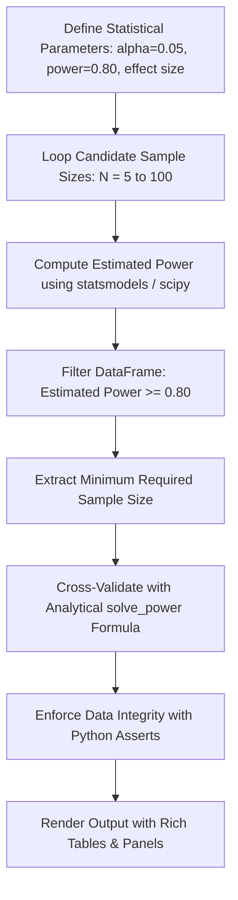

# NYAYaRAG: Model Evaluation and Statistical Analysis Guide
## A Data Scientist's Guide to Notebook 2 & Experimental Power Analysis

---

## 1. Executive Summary: What is Notebook 2 and Why Does It Exist?

In production AI and standard data science tutorials, model evaluation is often reduced to computing simple averages over a handful of test examples (e.g., *"Model A achieved 74% Recall and Model B achieved 79%"*).

In high-stakes domains like **Law (Indian Supreme Court Judgments)**, this naive approach fails because:
1. **Random Chance vs. Real Superiority**: A small percentage difference can easily be an artifact of question difficulty or small sample noise.
2. **Annotation Cost**: Creating legally valid benchmark questions and having senior advocates or legal scholars grade retrieval chunks and citations is extraordinarily expensive and time-consuming.
3. **Statistical Power**: If you test on too few questions, you risk a **Type II error (False Negative)**—failing to detect that your semantic retriever or LLM is genuinely superior. If you annotate too many, you waste immense manual labor.

**Notebook 2** (implemented as Python scripts in `notebook_2/`) provides the **prospective statistical power analysis and experimental methodology**. It mathematically determines the minimum required benchmark sample size **before any evaluation questions are annotated**, ensuring that all statistical hypothesis tests have at least an **80% probability ($\text{Power} = 0.80$)** of detecting meaningful performance differences.

---

## 2. The 4 Research Questions (RQ1 – RQ4)

In a Retrieval-Augmented Generation (RAG) framework, you must independently evaluate:
- The **retrieval paradigm** (Lexical vs. Semantic).
- The **individual retrieval algorithms** (TF-IDF, BM25, E5, BGE, InLegalBERT, Hybrid).
- The **answer generation quality** (Faithfulness, citation correctness).
- The **abstention safety mechanism** (Declining to answer unanswerable queries).

| Research Question | Plain-English Motivation | Statistical Design | Primary Statistical Test |
| :--- | :--- | :--- | :--- |
| **RQ1** | Does understanding legal semantics beat keyword matching? | Paired Repeated-Measures | One-Sided Wilcoxon Signed-Rank Test |
| **RQ2** | Which individual retriever (among the 6 models) performs best? | Multi-group Repeated-Measures | Friedman Test with Holm Post-Hoc Correction |
| **RQ3** | Does NYAYaRAG generate citation-grounded legal answers exceeding acceptable quality? | One-Sample Design | One-Sample Wilcoxon Signed-Rank Test |
| **RQ4** | Can NYAYaRAG reliably detect insufficient evidence and safely abstain from answering? | Binary Outcome (Success / Failure) | Exact One-Sided Binomial Test |

---

## 3. Core Statistical Concepts Explained for Data Scientists

### 3.1 Type I Error ($\alpha$) vs. Type II Error ($\beta$)
- **Type I Error ($\alpha = 0.05$)**: The probability of a *False Positive*—claiming a model is superior when the difference was merely random noise. We cap this at 5%.
- **Type II Error ($\beta = 0.20$)**: The probability of a *False Negative*—failing to detect a genuine performance improvement because our test dataset was too small.

### 3.2 Statistical Power ($1 - \beta = 0.80$)
Statistical power is the probability of correctly rejecting a false null hypothesis. Setting target power to **0.80 (80%)** guarantees that if our semantic retriever truly outperforms BM25 by the assumed effect size, our experiment has an 80% chance of reaching statistical significance ($p < 0.05$).

### 3.3 Effect Size
Effect size measures the *magnitude* of the difference between models, independent of sample size:
- **Cohen's $d_z = 0.50$ (RQ1 & RQ3)**: Standardized mean difference divided by the standard deviation of paired differences (a conventional moderate effect size).
- **Kendall's Concordance $W = 0.20$ (RQ2)**: Measures rank agreement across the 6 retrieval models. A conservative $W = 0.20$ reflects moderate differentiation in model rankings.
- **Proportion Difference $p_1 - p_0 = 0.85 - 0.60$ (RQ4)**: The gap between anticipated system abstention accuracy ($85\%$) and the null acceptance benchmark ($60\%$).

---

## 4. Deep Dive into the Statistical Tests

### 4.1 Why Non-Parametric Tests?
Parametric tests (like the Student's t-test or standard ANOVA) assume data follows a normal bell curve. Information Retrieval (IR) metrics like **Recall@k, MRR, nDCG@k, and Hit Rate@k** violate these assumptions:
- They are bounded between $0.0$ and $1.0$.
- They are heavily skewed and frequently contain tied values (e.g., questions where both models scored 1.0 or 0.0).

Therefore, non-parametric rank-based tests are required:

### 4.2 RQ1: One-Sided Wilcoxon Signed-Rank Test
- **Setup**: Every benchmark question is fed to both the lexical pipeline (TF-IDF, BM25) and the semantic pipeline (E5, BGE, InLegalBERT).
- **Paired Design**: Because the exact same questions are used, observations are paired ($X_{\text{semantic}} - X_{\text{lexical}}$), controlling for query difficulty.
- **Hypotheses**:
  - $H_{01}$: Semantic retrieval does not provide significantly higher performance than lexical retrieval.
  - $H_{11}$: Semantic retrieval provides significantly higher performance than lexical retrieval (one-sided).

### 4.3 RQ2: Friedman Test with Holm Post-Hoc Correction
- **Setup**: Comparing 6 models simultaneously on each question (TF-IDF, BM25, E5, BGE, InLegalBERT, Hybrid).
- **Friedman Test**: Ranks the 6 models for each query and evaluates whether the mean ranks differ significantly across algorithms ($df = 6 - 1 = 5$).
- **Holm Correction**: If the Friedman test is significant, pairwise Wilcoxon comparisons are run. The Holm step-down method adjusts $p$-values to prevent false discoveries across multiple pairwise comparisons.

### 4.4 RQ3: One-Sample Wilcoxon Signed-Rank Test
- **Setup**: Judges evaluate generated legal answers on a 5-point rubric (legal correctness, grounding, citation accuracy).
- **Threshold**: Compares median answer-quality scores against a baseline passing benchmark ($3.0$).
- **Hypotheses**:
  - $H_{03}: \text{Median} \leq 3.0$
  - $H_{13}: \text{Median} > 3.0$

### 4.5 RQ4: Exact One-Sided Binomial Test
- **Setup**: Unanswerable legal questions (queries where 2024 Supreme Court judgments have no supporting evidence) are processed.
- **Binary Outcome**:
  - *Success (Correct Abstention)*: System recognizes insufficient evidence and refuses to answer.
  - *Failure (Hallucination)*: System fabricates an unsupported legal answer.
- **Benchmark Selection**:
  - $50\%$ Benchmark: Weak standard (just better than coin toss).
  - $70\%$ Benchmark: Extremely demanding standard (requires 49 questions).
  - **$60\%$ Benchmark**: Optimal balance (requires 21 questions).

---

## 5. How the Python Code & DataFrames Work

Each script follows a rigorous, reproducible 5-stage architecture:



### Example: How the Power Curve DataFrame is Generated
```python
power_model = TTestPower()
power_results = []

for n_questions in range(5, 101):
    estimated_power = power_model.power(
        effect_size=0.50,
        nobs=n_questions,
        alpha=0.05,
        alternative="larger"
    )
    power_results.append({
        "Evaluation Questions": n_questions,
        "Assumed Effect Size (d_z)": 0.50,
        "Estimated Power": estimated_power,
        "Target Power Achieved": estimated_power >= 0.80
    })

rq1_power_results = pd.DataFrame(power_results)

# Find first N where power >= 0.80:
min_n = rq1_power_results.loc[
    rq1_power_results["Target Power Achieved"], "Evaluation Questions"
].iloc[0]  # Returns 27 questions!
```

---

## 6. Final Evaluation Dataset Allocation Matrix

From [07_final_sample_size_decisions_summary.py](file:///d:/_ResearchNotebooks\NyayaRAG\notebook_2\07_final_sample_size_decisions_summary.py):

| Research Question | Evaluated Metric | Minimum Required $N$ | Final Decided $N$ | Statistical Power Achieved |
| :---: | :--- | :---: | :---: | :---: |
| **RQ1** | Paired Retrieval (Recall, MRR, nDCG) | **27 questions** | **50 questions** | **0.967** (Heavily Powered) |
| **RQ2** | 6-Model Friedman Comparison | **13 questions** | **50 questions** | **1.000** (Full Power) |
| **RQ3** | Answer Quality (Rubric Median > 3.0) | **27 questions** | **50 questions** | **0.967** (Heavily Powered) |
| **RQ4** | Safe Abstention (60% Threshold) | **21 questions** | **25 questions** | **0.803** (Meets Target) |

### The 75-Question Benchmark Allocation
- **50 Answerable Questions**: Used simultaneously across RQ1, RQ2, and RQ3.
- **25 Unanswerable Questions**: Used exclusively for RQ4 abstention evaluation.
- **Total Benchmark**: **75 manually curated legal research questions**.

---

## 7. Script Directory Reference

All scripts are located in `d:\_ResearchNotebooks\NyayaRAG\notebook_2\`:

1. `01_research_questions_and_statistical_plan.py`: Defines the formal research questions, hypotheses, and evaluation metrics matrix.
2. `02_statistical_assumptions_sample_size.py`: Encapsulates methodological assumptions ($\alpha$, power, study designs).
3. `03_sample_size_determination_rq1.py`: Runs prospective power analysis for paired Wilcoxon lexical vs. semantic comparison.
4. `04_sample_size_determination_rq2.py`: Implements asymptotic non-central chi-square power approximation for the Friedman test.
5. `05_sample_size_determination_rq3.py`: Executes one-sample normal approximation for LLM answer-quality evaluation.
6. `06_sample_size_determination_rq4.py`: Computes exact binomial probabilities across 50%, 60%, and 70% abstention benchmarks.
7. `07_final_sample_size_decisions_summary.py`: Synthesizes final dataset sizing decisions and allocation breakdown.
8. `08_run_all_power_analyses.py`: Master pipeline runner executing all validations sequentially.
